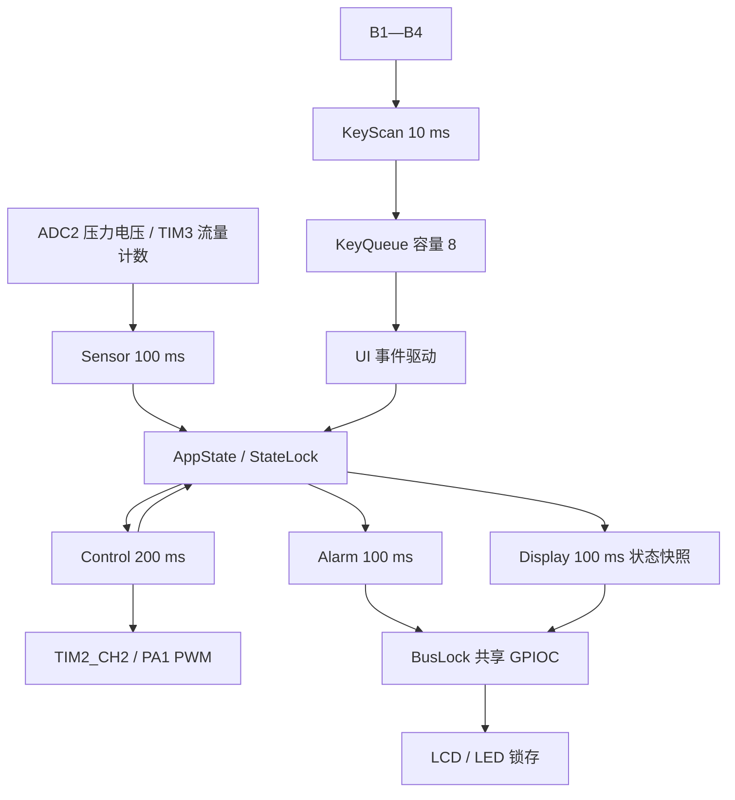

# PF-MCS-freeRTOS

**基于 STM32G431 与 FreeRTOS 的压力与流量监测控制系统**

Pressure & Flow Monitoring and Control System


[](https://github.com/YingXin0128/PF-MCS-freeRTOS/actions/workflows/source-check.yml)

面向 CT117E-M4 开发板的嵌入式项目：通过 ADC 采集压力模拟电压，通过定时器统计流量脉冲，使用 PWM 输出控制量，并通过 LCD、按键和 LED 完成人机交互与异常提示。应用以六个 FreeRTOS 任务组织，覆盖采集、控制、按键、界面、告警和显示。

本仓库从 `RTOS_ES17` 上板工程整理而来，只保留实际硬件目标及其构建依赖。支持的构建入口为 [`MDK-ARM/PF-MCS-freeRTOS.uvprojx`](MDK-ARM/PF-MCS-freeRTOS.uvprojx)。

> **验证说明**：仓库中的软件测试执行实际 `Src/app.c`，使用主机侧测试桩提供输入和时间。文中的软件结果与理论值均已标注，不能当作开发板测量记录。硬件 PWM、ADC 精度、任务抖动和真实压力闭环性能需要上板验证，详见 [验证报告](docs/VALIDATION.md)。

## 导航

- [功能与技术栈](#功能与技术栈)
- [系统架构](#系统架构)
- [算法与实现](#算法与实现)
- [硬件连接](#硬件连接)
- [编译与下载](#编译与下载)
- [界面与操作](#界面与操作)
- [测试与数据](#测试与数据)
- [目录结构](#目录结构)
- [使用边界](#使用边界)
- [许可证与来源](#许可证与来源)

## 功能与技术栈

| 层次 | 技术 / 模块 | 具体实现 |
| --- | --- | --- |
| 硬件平台 | STM32G431RBT6 / Cortex-M4F | HSI 经 PLL 配置 80 MHz 系统时钟 |
| 底层驱动 | STM32 HAL + CMSIS | ADC2、TIM2、TIM3、GPIO、SysTick 与中断向量 |
| 实时内核 | FreeRTOS V10.3.1 | 抢占式调度、1 kHz Tick、六个应用任务 |
| 任务通信 | Queue / Mutex | 按键事件队列、业务状态互斥、LCD/LED 总线互斥 |
| 采集算法 | 均值、定点映射、计数差分 | 8 次 ADC 均值、零点校准、100 ms 流量计数窗 |
| 控制算法 | 限速步进 + 压力死区 | 手动目标跟踪、自动压力反馈、PWM 输出限幅 |
| 告警算法 | 组合阈值 + 持续时间判定 | 传感器超频、堵塞条件、泄漏条件 |
| 人机界面 | LCD 三页状态机 + 四按键 | 参数暂存与提交、模式切换、长按校准与清零 |
| 开发验证 | Keil MDK / ARMCC 5 / Python | 上板工程全量编译、主机 C 算法回归、仓库完整性检查 |

已实现：

- 显示压力 `P`、瞬时流量 `F`、累计流量 `Q`、占空比 `D` 和校准零点 `V`。
- 输出 10 kHz PWM，占空比限制在 5%～95%。
- 手动模式逐步跟踪目标占空比；自动模式根据目标压力与反馈压力的偏差调节。
- 设置页编辑参数时使用暂存副本，切换到下一页时统一提交。
- 持续异常经过延时确认后点亮对应 LED；条件恢复后在后续告警判定中清除。
- 使用状态快照刷新 LCD，切页时清屏，普通刷新补齐行尾空格。

## 系统架构



| 任务 | 周期 / 触发 | 优先级¹ | 栈深度² | 职责 |
| --- | --- | ---: | ---: | --- |
| `Sensor` | 100 ms | 4 | 256 | 电压采集、压力换算、流量换算与积分 |
| `KeyScan` | 10 ms | 4 | 256 | 三次稳定采样去抖、生成按下/释放事件 |
| `UI` | 阻塞等待队列 | 3 | 320 | 页面状态机、暂存编辑与参数提交 |
| `Control` | **200 ms** | 3 | 256 | 每次将占空比调整 1 个百分点 |
| `Alarm` | 100 ms | 2 | 256 | 组合条件计时、LD1～LD4 更新 |
| `Display` | 100 ms | 1 | 512 | 复制业务快照、格式化并显示 |

¹ 相对于 `tskIDLE_PRIORITY`。² 单位为 `StackType_t` 字，当前端口每字 4 字节；六个任务的声明栈空间合计 7,424 字节，不等于实测最大栈占用。

周期任务使用 `vTaskDelayUntil()` 维持周期基准。`StateLock` 保护共享状态；`BusLock` 保护 LCD 和 LED 共用的 GPIOC 数据线。显示任务先复制状态并释放 `StateLock`，再持有 `BusLock` 执行 LCD 操作，减少慢速外设访问对业务状态的阻塞。

FreeRTOS 使用 `heap_4`，配置堆大小 14 KiB，开启栈溢出检测和动态内存申请失败钩子。严重错误进入 `Error_Handler()` 停机等待调试。

## 算法与实现

### 1. ADC 均值与压力零点校准

ADC2 对 PB15 连续进行 8 次软件触发采样，取样后直接合并换算为毫伏，整数运算包含四舍五入：

```text
voltage_mv = (sum(adc[0..7]) × 3300 + 4095 × 4) / (4095 × 8)
```

压力以 `0.1 BAR` 为内部单位。设采集电压为 `v`、校准零点为 `v0`，两者均以 mV 表示：

```text
P10 = round((v - v0) × 100 / (3300 - v0))
P   = P10 / 10 BAR
```

`v <= v0` 或 `v0 >= 3300` 时返回 0；其余结果限制在 0～100，即 0.0～10.0 BAR。MAIN 页长按 B3 至少 2 秒并释放，将当时的采集电压记为零点；校准后重新计算有效量程斜率。

### 2. 定时器计数与流量换算

TIM3 以 PB4 上升沿作为外部计数时钟。每 100 ms 读取一次计数器，使用 16 位无符号差分处理一次计数回绕：

```text
pulses = uint16(now - previous)
frequency_hz = pulses × 10
```

| 频率条件 | 瞬时流量 | LD1 |
| --- | --- | --- |
| `< 800 Hz` | 0.0 L/min | 熄灭 |
| `800～8000 Hz` | `F10 = (frequency_hz + 10) / 20`，显示 `F10 / 10` | 熄灭 |
| `> 8000 Hz` | 钳位到 40.0 L/min | 点亮 |

正常区间等价于 `F = frequency_hz / 200 L/min`，再量化到 0.1 L/min。100 ms 计数窗带来的频率分辨率为理论 10 Hz。

### 3. 累计流量的余数积分

瞬时流量以 `0.1 L/min` 表示，采样周期为 0.1 s，每次采样对应 `F10 / 6000 L`。程序把 `F10` 加入整数余数，余数每满 6000 时累计 1 L，并保留不足 1 L 的部分。

这避免了每次采样都向下取整造成的小流量丢失。累计显示上限为 `999999999 L`，达到上限后停止增加；MAIN 页长按 B4 至少 2 秒并释放可同时清除累计值和积分余数。

### 4. 手动斜坡与自动死区控制

当前源码控制周期为 **200 ms**，每周期最多调整 **1 个百分点**，标称变化速率为 5 个百分点/秒。

| 模式 | 判定 | 下一次占空比 |
| --- | --- | --- |
| `MAN` | 当前值低于 / 高于 `TarD` | 加 1 / 减 1 个百分点 |
| `MAN` | 当前值等于 `TarD` | 保持 |
| `AUTO` | `P < TarP - 0.5 BAR` | 加 1 个百分点 |
| `AUTO` | `P > TarP + 0.5 BAR` | 减 1 个百分点 |
| `AUTO` | `TarP - 0.5 <= P <= TarP + 0.5 BAR` | 保持 |

软件控制和 PWM 驱动均按各自路径维护 5%～95% 输出范围。该实现属于带死区的步进反馈控制，**未实现 PID、自适应控制或卡尔曼滤波**；死区与步进限制用于减少小误差下的反复调节，真实闭环效果取决于受控对象。

### 5. 按键去抖与页面状态机

按键以 10 ms 周期扫描，连续三次相同读数才更新稳定状态；按下和释放分别生成事件。去抖响应约为 20～30 ms，取决于输入相对扫描时刻的相位。长按时长根据去抖后的稳定边沿计算。

页面按 `MAIN → OUTP → PARA → MAIN` 循环。进入设置页时复制参数，B3/B4 修改暂存值，B1 离开对应设置页时提交，使界面编辑与控制使用的生效参数分开。

### 6. 组合条件与告警持续时间

| LED | 条件 / 含义 | 触发方式 |
| --- | --- | --- |
| LD1 | 流量输入频率 `> 8000 Hz` | 传感器任务置位，告警任务刷新 |
| LD2 | `F < FL` 且 `D > DH`，作为堵塞判据 | 连续有效判定超过 2000 ms |
| LD3 | `F > FH` 且 `P < PL`，作为泄漏判据 | 连续有效判定超过 2000 ms |
| LD4 | 提交相关目标参数后设置的“调整中”标志 | 达到手动目标或进入自动压力死区时清除 |
| LD5～LD8 | 未使用 | 保持熄灭 |

LD2/LD3 每次有效采样增加 100 ms，代码采用严格 `> 2000`，第 21 次连续有效判定时置位。条件失效后重置计时与告警；恢复不是额外延时 2 秒。

## 硬件连接

| 信号 | MCU 引脚 / 外设 | 连接或说明 |
| --- | --- | --- |
| 压力模拟输入 | PB15 / ADC2_IN15 | 板载 R37；V1.2 的 J11 选择 A02–PB15，1–2 短接 |
| 流量脉冲输入 | PB4 / TIM3_CH1 | 板载 R39 脉冲源；短接 J9 |
| PWM 输出 | PA1 / TIM2_CH2 | 扩展排针，标称 10 kHz、5%～95% |
| B1 / B2 / B3 / B4 | PB0 / PB1 / PB2 / PA0 | 低电平有效 |
| LCD 数据 | PC0～PC15 | 并行数据总线 |
| LCD 控制 | PB5 / PB8 / PB9 / PA8 | 沿用板载 LCD 驱动 |
| LED 数据 / 锁存 | PC8～PC15 / PD2 | 与 LCD 高 8 位共享；74LS573 锁存 |
| SWD | PA13 / PA14 | 留给调试下载接口 |

该接线说明沿用源工程的 CT117E-M4 板卡约定；操作前按实际板卡丝印核对跳线。外部信号需共地并满足 3.3 V 输入范围。PA1 为逻辑控制输出，外接执行器时需要匹配的驱动电路。

## 编译与下载

### 开发环境

- Keil MDK 5，使用 **ARM Compiler 5**；本次验证版本为 ARMCC 5.05 update 1 build 106。
- STM32G4 器件支持包：工程记录 `Keil.STM32G4xx_DFP.1.3.0`，本次按该版本验证。
- 上板源码依赖已随仓库保留。编译器、Keil 软件、DFP 安装包不随仓库分发。
- 当前 FreeRTOS 端口为 `portable/RVDS/ARM_CM4F`，不能直接把编译器切到 ARM Compiler 6 而不适配端口。

### 用 Keil 编译

1. 克隆或下载本仓库，打开 `MDK-ARM/PF-MCS-freeRTOS.uvprojx`。
2. 选择 `PF-MCS-freeRTOS` Target，确认器件 `STM32G431RBTx` 与 ARM Compiler 5。
3. 执行 **Rebuild all target files**，确认 0 Error、0 Warning。
4. 在 `build/` 中得到 `PF-MCS-freeRTOS.hex` 和 `PF-MCS-freeRTOS.axf`。

也可以使用 PowerShell 构建脚本：

```powershell
# 路径替换为本机 UV4.exe 的安装位置
.\tools\build.ps1 -UV4Path 'C:\Keil_v5\UV4\UV4.exe'
```

脚本全量编译并检查返回码、HEX 是否新生成，输出 SHA-256。原始构建日志只留在被 Git 忽略的 `build/` 目录。

### 存储配置与下载

| 区域 | 起始地址 | 工程使用容量 |
| --- | --- | --- |
| Flash | `0x08000000` | `0x20000`，128 KiB |
| SRAM | `0x20000000` | `0x8000`，32 KiB |

通过板载 CMSIS-DAP / SWD 下载新生成的 HEX，执行校验后复位。HEX 自带地址；如自行导出 BIN，应使用 Flash 基址 `0x08000000`。上电后进入 `MAIN / MAN`，PWM 从 5% 开始。更详细的接线与下载排查见 [硬件指南](docs/HARDWARE.md)。

## 界面与操作

| 页面 | B1 | B2 | B3 | B4 |
| --- | --- | --- | --- | --- |
| `MAIN` | 进入 OUTP | 切换 MAN / AUTO | 长按 ≥2 s 后释放：零点校准 | 长按 ≥2 s 后释放：累计清零 |
| `OUTP` | 提交输出参数，进入 PARA | 切换 TarD / TarP | 增加选中值 | 减少选中值 |
| `PARA` | 提交安全参数，返回 MAIN | 循环选择 FH / FL / PL / DH | 增加选中值 | 减少选中值 |

| 参数 | 含义 | 默认值 | 可调范围 | 单次步长 |
| --- | --- | --- | --- | --- |
| `TarD` | 手动目标占空比 | 5% | 5%～95% | 5 个百分点 |
| `TarP` | 自动目标压力 | 5.0 BAR | 1.0～9.5 BAR | 0.5 BAR |
| `FH` | 流量上阈值 | 20.0 L/min | 4.0～40.0 L/min | 1.0 L/min |
| `FL` | 流量下阈值 | 10.0 L/min | 4.0～40.0 L/min | 1.0 L/min |
| `PL` | 压力下阈值 | 1.0 BAR | 1.0～9.5 BAR | 0.5 BAR |
| `DH` | 占空比阈值 | 65% | 5%～95% | 10 个百分点，边界钳位 |

`MAIN` 页中的 `V` 表示校准零点电压，按一位小数显示；它不是当前 ADC 输入电压。长按操作在释放时生效。设置页 B3/B4 按一次调整一次，没有长按连加功能。

## 测试与数据

2026-10-24 在本仓库目录完成 ARMCC 5 全量编译与链接：**0 Error、0 Warning**。Code/RO/RW 合计 24,864 字节，静态 RAM（RW+ZI）16,008 字节。新 HEX 的地址与字节内容与整理前的上板版本一致。

提供可重跑的软件测试：编译并执行当前 `Src/app.c`，覆盖压力映射、流量积分、控制步进、告警、参数提交及按键去抖。测试桩只在临时目录生成，不会成为上板固件的一部分。

```bash
python tools/verify_repository.py
python tools/test_algorithms.py --cc clang
# 使用 Zig 时，将 --cc 指向 zig 或 zig.exe
```

修改上板源码后，重新运行本地 Keil 构建，再执行 `python tools/record_build.py` 更新构建记录；使用 `python tools/test_algorithms.py --cc clang --report docs/data/software-tests.json` 更新算法记录，最后执行仓库检查。记录文件包含源码哈希，过期记录会使检查失败。

以下是软件算法测试或参数推导结果，**全部不是硬件实测**：

| 场景 | 输入 / 条件 | 软件结果或理论值 | 数据性质 |
| --- | --- | --- | --- |
| 压力映射 | 1650 mV，零点 0 mV | 5.0 BAR | 实际 C 函数主机执行 |
| 校准映射 | 1800 mV，零点 300 mV | 5.0 BAR | 实际 C 函数主机执行 |
| 流量换算 | 4000 Hz | 20.0 L/min | 实际 C 任务逻辑主机执行 |
| 超频保护 | 8010 Hz | 40.0 L/min、传感器告警置位 | 实际 C 任务逻辑主机执行 |
| 累计流量 | 20.0 L/min，600 个 100 ms 周期 | 20 L | 实际 C 任务逻辑主机执行 |
| 手动斜坡 | 5% → 65%，60 个控制周期 | 12.0 s 软件时间 | 实际 C 任务逻辑主机执行 |
| 自动死区 | TarP=5.0 BAR，反馈 4.5 / 5.0 / 5.5 BAR | 占空比保持 | 实际 C 任务逻辑主机执行 |
| 自动步进 | TarP=5.0 BAR，反馈 4.4 / 5.6 BAR | 每周期 +1 / −1 个百分点 | 实际 C 任务逻辑主机执行 |
| 持续告警 | 堵塞条件连续有效 | 第 20 次不报，第 21 次置 LD2 | 实际 C 任务逻辑主机执行 |
| PWM 参数 | 80 MHz / 8000 | 10,000 Hz；周期 100 μs | 定时器配置推导 |

完整边界、验证环境及待上板项目见 [docs/VALIDATION.md](docs/VALIDATION.md)，机器可读的软件断言结果见 [docs/data/software-tests.json](docs/data/software-tests.json)。

## 目录结构

```text
PF-MCS-freeRTOS/
├── README.md                    # 项目介绍、技术、算法、运行方法
├── LICENSE                      # 本项目代码授权范围说明
├── THIRD_PARTY_NOTICES.md        # 第三方来源与许可证对应关系
├── LICENSES/                    # 随库保留的第三方许可证文本
├── Inc/                         # 应用接口、HAL/FreeRTOS 配置、字体
├── Src/                         # 应用、硬件 BSP、LCD 与中断实现
├── Drivers/                     # 当前目标实际依赖的 HAL / CMSIS
├── Middlewares/                 # FreeRTOS 内核、RVDS 端口、heap_4
├── MDK-ARM/                     # 唯一上板工程和 STM32G431 启动文件
├── docs/                        # 硬件、验证、GitHub 上传说明
│   └── data/                    # 软件测试结果，明确标注来源
├── tools/                       # 构建、源码算法回归、仓库检查
├── .github/workflows/           # GitHub 自动检查
├── .gitignore                   # 忽略输出、日志和个人配置
├── .gitattributes               # Git 文本与换行规则
└── .editorconfig                # 编辑约定
```

构建后出现的 `build/` 是本地输出，不应上传。源码阅读从 `Src/main.c → Src/bsp.c → Src/app.c` 开始。首次上传步骤见 [GitHub 发布指南](docs/GITHUB_UPLOAD.md)。

## 使用边界

- 本次未连接开发板；不提供虚构的 ADC 误差、示波器波形、CPU 占用率、栈峰值或连续运行时长。
- 流量计数窗按标称 100 ms 换算；实际调度延迟会引入计量误差，当前未按实际经过时间补偿。
- 参数、零点和累计流量都只保存在 RAM，复位后恢复默认值。
- 当前未检查 `FL <= FH` 的参数关联关系，设置时应自行保持合理阈值。
- 按键队列容量为 8，队列满时发送失败没有单独计数；需在后续压力测试中检查事件丢失情况。
- LD4 表示特定参数提交所触发的调整状态，不能作为所有自动调节动作的完整指示。
- 未建立实际管路或泵的动态模型；自动模式的稳定性、响应时间与超调量需要结合实际对象测试。

## 许可证与来源

FreeRTOS、STM32 HAL/CMSIS 与板载 LCD 示例保留各自的版权及适用条件，见 [THIRD_PARTY_NOTICES.md](THIRD_PARTY_NOTICES.md)。本仓库没有把整套来源不同的代码统一声明为 MIT；项目自有部分的授权范围见 [LICENSE](LICENSE)。
